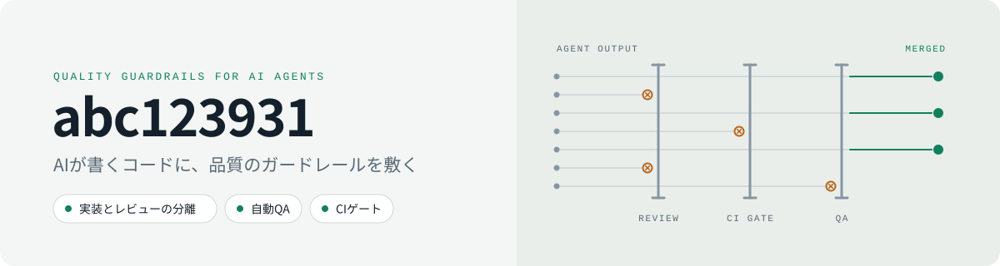

<picture>
  <source media="(prefers-color-scheme: dark)" srcset="./assets/banner-dark.svg">
  
</picture>

AI エージェントがコードを書く前提で、**品質が落ちない仕組み（ガードレール）** を設計・運用しているエンジニアです。人がすべてをレビューしきれなくても事故が起きないよう、テスト・レビュー・QA を仕組みに落とし込むことに取り組んでいます。

## 取り組み

<table>
  <tr>
    <td width="200"><b>Neiro</b> 自社サービス</td>
    <td>
      AI エージェントに実装を任せつつ、品質を仕組みで守る運用を実践しています。
      <ul>
        <li>実装役とレビュー役の AI を分離</li>
        <li>マージ後に別の AI が自動で QA</li>
        <li>独自の CI ゲート</li>
        <li>skill の効果を eval で測定</li>
      </ul>
    </td>
  </tr>
  <tr>
    <td><b>GameHint / assort</b> チーム開発</td>
    <td>2 人・4 人のチームで、企画・設計・実装・インフラ・運用までを主導しました。</td>
  </tr>
  <tr>
    <td><b>pstack</b> OSS 貢献</td>
    <td>Claude Code 向けプラグイン pstack に、クラウド環境で「案内オフ」の設定が次のセッションに引き継がれない不具合を再現して報告しました（<a href="https://github.com/michael-denyer/pstack-claude/issues/479">#479</a>）。</td>
  </tr>
</table>

## 公開リポジトリ

<table>
  <tr>
    <td width="200"><a href="https://github.com/abc123931/tdd-autoreview-demo"><b>tdd-autoreview-demo</b></a></td>
    <td>厳格な TDD と自動コードレビュー（CI ＋ AI レビュー）で信頼を担保する開発ワークフローの雛形。</td>
  </tr>
  <tr>
    <td><a href="https://github.com/abc123931/slack-context-mcp"><b>slack-context-mcp</b></a></td>
    <td>Slack の会話を、LLM が読みやすい文脈に整えて渡す MCP サーバー。</td>
  </tr>
</table>
